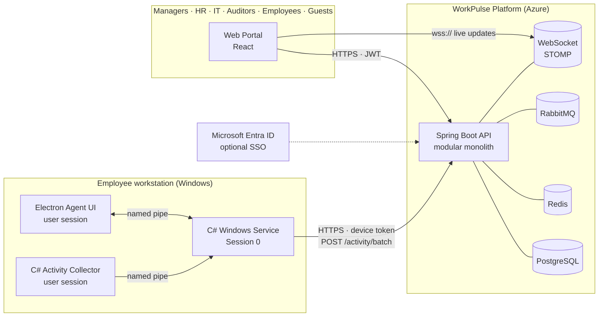
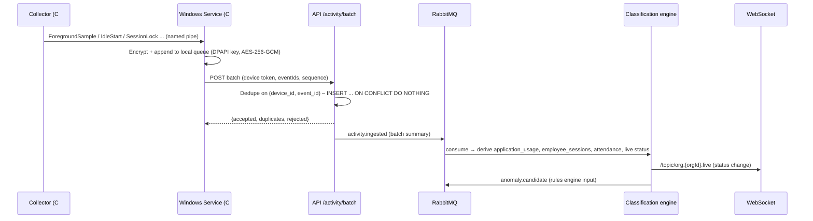
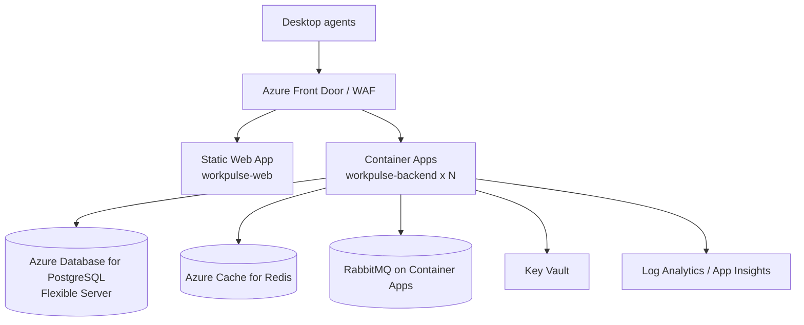

# WorkPulse – Architecture Overview

WorkPulse is an enterprise workforce-intelligence platform made of three independently
maintainable applications that share one set of contracts:

| Application | Technology | Purpose |
|---|---|---|
| **Web Management Portal** (`workpulse-web/`) | React 19 · Vite 7 · TypeScript 5 · Material UI 7 · SCSS · Redux Toolkit | Management, analytics, employee self-service, guest demo |
| **Windows Desktop Agent** (`workpulse-agent/`) | Electron 38 + TypeScript UI · C#/.NET 8 collector · C#/.NET 8 Windows Service | Visible, employee-facing activity collection and synchronisation |
| **Backend & Analytics Platform** (`workpulse-backend/`) | Java 17 · Spring Boot 3.5 · PostgreSQL 16 · Redis 7 · RabbitMQ 3.13 · WebSockets | APIs, event ingestion, classification, analytics, RBAC, audit |

## 1. System context



## 2. Backend: modular monolith

One deployable Spring Boot application, organised as vertical modules under `com.workpulse.*`.
Every module owns its entities, repositories, services, DTOs and controllers. Cross-module
calls go through service interfaces, never through repositories of another module.

```
com.workpulse
├── config/        Spring configuration (Jackson, CORS, OpenAPI, async, Redis, RabbitMQ, WebSocket)
├── security/      JWT, refresh-token rotation, device-token auth, RBAC, tenant (organisation) context
├── exception/     Global exception handler + API error model
├── common/        Base entity, API envelope, pagination, auditing, utilities
├── auth/          Login, logout, refresh, password reset, MFA (later), SSO (later), login audit
├── users/         Platform users, role assignment, invitations, activation
├── organizations/ Organisations and organisation settings
├── departments/   Departments
├── teams/         Teams
├── employees/     Employee directory, manager assignments, CSV import
├── devices/       Device inventory, approval, revocation, agent versions
├── agent/         Agent registration, heartbeat, policy delivery, update channel
├── activity/      Event ingestion (idempotent), timeline, employee sessions, classification
├── applications/  Application catalogue, classification rules, usage aggregation
├── attendance/    Attendance records, breaks, corrections
├── shifts/        Shift configuration
├── analytics/     Dashboard overview, department/team analytics
├── anomaly/       Rules engine, anomaly events, review workflow
├── notifications/ Notification centre
├── reports/       Report generation and export (CSV/PDF/XLSX)
├── policies/      Monitoring policies and assignments, effective-policy resolution
├── privacy/       Acknowledgements, my-data, deletion workflows
├── audit/         Audit log + data-access log
├── guest/         Public demo guest + authorised guest accounts, demo data seeding/reset, demo activity simulator
└── websocket/     Live workforce broadcast
```

### Request lifecycle

1. `JwtAuthenticationFilter` (users and guests) or `DeviceTokenAuthenticationFilter` (agents) authenticates.
2. `TenantContext` is populated from the token (`org` claim). Every repository query is
   organisation-scoped. `SUPER_ADMIN` may address any organisation explicitly.
3. Controllers validate DTOs with Jakarta Validation, call services and return the standard envelope.
4. Method security (`hasAuthority('EMPLOYEE_VIEW')`) enforces permissions **in the backend**.
   Data scope (ORGANIZATION / DEPARTMENT / TEAM / SELF) is applied by `AccessScopeService`
   inside the service layer, so a Team Lead can never read another team's data even with a
   crafted request.
5. Privileged writes and employee-data reads publish an `AuditEvent`; `AuditService` persists it.

### Activity pipeline



Phase 1 ships the ingestion endpoint, deduplication, storage and a synchronous
live-status update. Asynchronous consumers (RabbitMQ) are introduced in Phase 6.

## 3. Multi-tenancy and data isolation

* Every tenant-owned table carries `organization_id` (NOT NULL, indexed).
* `TenantContext` is a request-scoped holder set by the auth filters.
* Repositories expose only organisation-scoped finders (`findByIdAndOrganizationId`).
* Integration tests assert that a user of organisation A receives `404`, never `403`,
  for organisation B resources (no existence leakage).
* The **demo organisation** (`is_demo = true`) is a normal tenant populated with
  simulated data. Public guests are scoped to it and to a read-only permission set.

## 4. Security architecture

| Concern | Implementation |
|---|---|
| User auth | JWT access token (15 min, HS256 with a 256-bit secret; RS256 optional) + opaque refresh token (7 days) stored **hashed**; rotated on every refresh, reuse detection revokes the whole token family |
| Device auth | Opaque device token issued at registration approval, stored hashed (SHA-256), sent as `X-Device-Token`; revocable per device |
| Authorisation | Permission authorities in token claims; method security on controllers; scope checks in services |
| Guest | Public demo guest = short-lived JWT bound to the demo org with role `GUEST_DEMO`; authorised guest = invited account with expiry, scope and permission set |
| Transport | HTTPS everywhere (Azure Front Door terminates TLS); HSTS |
| Secrets | Environment variables locally, Azure Key Vault in cloud; never shipped to the renderer or browser |
| Rate limiting | Redis-backed token bucket on `/auth/**`, `/guest/**` and `/activity/batch` per IP / device |
| Audit | Every privileged write and every employee-data read is logged (`audit_logs`, `data_access_logs`) |
| Desktop | Electron `contextIsolation: true`, `sandbox: true`, `nodeIntegration: false`; preload exposes a typed, minimal bridge; installers and updates are code-signed |

## 5. Real-time

* Spring WebSocket (STOMP, SockJS fallback) at `/ws`.
* Topics: `/topic/org.{orgId}.live` (status deltas), `/topic/org.{orgId}.devices`,
  `/user/queue/notifications`.
* The JWT is sent in the STOMP `CONNECT` frame; a channel interceptor validates it and
  binds the session to the organisation.
* Redis pub/sub fans out broadcasts across multiple backend instances.

## 6. Activity classification (engine placement)

The classification engine runs **server-side** (module `activity.classification`) so that
rules are centrally versioned, auditable and explainable. The agent sends *facts*
(foreground app, idle gaps, lock state, aggregated input counts); the server derives
*states* (`ACTIVE_APPLICATION`, `FOCUS_SESSION`, `MEETING`, `IDLE`, `BREAK`, `LOCKED`,
`OFFLINE`, `UNKNOWN`) and stores a human-readable `reason` with every derived interval.

## 7. Deployment topology (Azure)



Environments: `dev` (Docker Compose), `test` (CI, Testcontainers), `staging`, `production`
– all driven by the same container images and environment-specific configuration.

## 8. Non-functional decisions

* **Timestamps** are UTC `timestamptz`; the agent sends ISO-8601 with offset.
* **Identifiers** are UUID v4 (events generated on the agent, entities on the server).
* **Idempotency**: `activity_events (device_id, event_id)` is unique; batch responses are
  deterministic so the agent can safely retry.
* **Partitioning**: `activity_events` is range-partitioned by month on `occurred_at`.
  Flyway creates the first partitions; a scheduled job creates future ones.
* **Retention**: per-policy retention days; a nightly job drops expired partitions and
  purges aggregated rows beyond retention.
* **Observability**: structured JSON logs, Micrometer metrics, `/actuator/health`
  readiness and liveness probes.
