# WorkPulse – Database Design (PostgreSQL 16)

Conventions

* UUID v4 primary keys (`gen_random_uuid()`), except reference/lookup tables.
* All timestamps are `timestamptz` and stored in UTC. Column names end in `_at`.
* Every tenant-owned table has `organization_id uuid NOT NULL` and an index on it.
* Soft state is modelled with explicit status columns, not deletes. Hard deletes only
  happen through the privacy deletion workflow and retention jobs.
* Audit columns: `created_at`, `updated_at`, `created_by`, `updated_by`.
* Migrations: Flyway, `workpulse-backend/src/main/resources/db/migration/V*__*.sql`.

## Entity–relationship diagram

```mermaid
erDiagram
    organizations ||--o{ users : has
    organizations ||--o{ departments : has
    organizations ||--o{ teams : has
    organizations ||--o{ employees : has
    organizations ||--o{ devices : has
    organizations ||--o{ monitoring_policies : has
    organizations ||--o{ shifts : has
    organizations ||--o{ guest_accounts : has
    organizations ||--o{ audit_logs : has

    users ||--o{ user_roles : has
    roles ||--o{ user_roles : grants
    roles ||--o{ role_permissions : has
    permissions ||--o{ role_permissions : in
    users ||--o{ refresh_tokens : owns
    users ||--o{ login_audit : has
    users |o--o| employees : "is linked to"

    departments ||--o{ teams : contains
    departments ||--o{ employees : contains
    teams ||--o{ employees : contains
    employees ||--o{ manager_assignments : "managed by"
    employees ||--o{ devices : assigned
    employees ||--o{ employee_policy_assignments : has
    monitoring_policies ||--o{ employee_policy_assignments : applies
    shifts ||--o{ employees : "works"

    devices ||--o{ device_tokens : authenticates
    agent_versions ||--o{ devices : runs

    devices ||--o{ activity_events : emits
    employees ||--o{ activity_events : "attributed to"
    employees ||--o{ employee_sessions : has
    devices ||--o{ employee_sessions : on
    employee_sessions ||--o{ activity_intervals : "classified into"
    employees ||--o{ application_usage : has
    application_catalog ||--o{ application_usage : of
    application_catalog ||--o{ application_classifications : "classified by"
    organizations ||--o{ application_classifications : defines

    employees ||--o{ attendance_records : has
    attendance_records ||--o{ breaks : contains
    employees ||--o{ employee_correction_requests : submits
    attendance_records ||--o{ employee_correction_requests : about

    employees ||--o{ anomaly_events : "flagged on"
    devices ||--o{ anomaly_events : "observed on"
    anomaly_events ||--o{ anomaly_reviews : has
    users ||--o{ notifications : receives
    employees ||--o{ privacy_acknowledgements : signs
    monitoring_policies ||--o{ privacy_acknowledgements : for

    guest_accounts ||--o{ guest_permissions : has
    guest_accounts ||--o{ guest_sessions : opens
    users ||--o{ data_access_logs : performs
    employees ||--o{ data_access_logs : "subject of"
```

## Tables

### Identity and tenancy

| Table | Key columns | Notes |
|---|---|---|
| `organizations` | id, name, slug (unique), code, timezone, status, is_demo, settings jsonb | `is_demo` marks the public-guest tenant |
| `users` | id, organization_id, email (unique per org), password_hash, display_name, status (INVITED/ACTIVE/SUSPENDED/REVOKED), mfa_enabled, mfa_secret_enc, last_login_at, employee_id (nullable FK) | Super admins have `organization_id` NULL |
| `roles` | id (uuid), code (unique), name, description, scope_level (GLOBAL/ORGANIZATION/DEPARTMENT/TEAM/SELF), is_system | System roles seeded by migration |
| `permissions` | id, code (unique, e.g. `EMPLOYEE_VIEW`), resource, action, description | Catalogue seeded by migration |
| `role_permissions` | role_id, permission_id | PK (role_id, permission_id) |
| `user_roles` | user_id, role_id, department_id?, team_id?, granted_by, granted_at | Scope binding for managers / leads |
| `refresh_tokens` | id, user_id, token_hash (unique), family_id, expires_at, revoked_at, replaced_by, user_agent, ip | Rotation + reuse detection |
| `login_audit` | id, user_id?, email, organization_id?, outcome, ip, user_agent, occurred_at | Also records failed attempts |
| `password_reset_tokens` | id, user_id, token_hash, expires_at, used_at | |

### Organisation structure

| Table | Key columns |
|---|---|
| `departments` | id, organization_id, name, code, parent_id?, head_employee_id?, status |
| `teams` | id, organization_id, department_id, name, code, lead_employee_id?, status |
| `employees` | id, organization_id, employee_code (unique per org), first_name, last_name, work_email, designation, department_id?, team_id?, shift_id?, joining_date, employment_status (ACTIVE/ON_LEAVE/INACTIVE/TERMINATED), role_profile (e.g. DEVELOPER, ANALYST – drives classification) |
| `manager_assignments` | id, organization_id, employee_id, manager_employee_id, assignment_type (LINE/DOTTED), effective_from, effective_to |
| `shifts` | id, organization_id, name, start_time, end_time, timezone, working_days int[], grace_minutes, break_minutes, overtime_after_minutes |

### Devices and agents

| Table | Key columns |
|---|---|
| `agent_versions` | id, version (unique), channel (STABLE/BETA), release_notes, download_url, sha256, is_mandatory, released_at |
| `devices` | id, organization_id, employee_id?, hostname, machine_id (unique per org), os_name, os_version, agent_version, status (PENDING/APPROVED/REVOKED/RETIRED), last_seen_at, last_sync_at, health (HEALTHY/DEGRADED/OFFLINE/UNKNOWN), registered_at, approved_by, approved_at, revoked_at, metadata jsonb |
| `device_tokens` | id, device_id, token_hash (unique), issued_at, expires_at?, revoked_at |

### Policies

| Table | Key columns |
|---|---|
| `monitoring_policies` | id, organization_id, name, level (ORGANIZATION/DEPARTMENT/TEAM/EMPLOYEE), target_id?, is_default, working_hours jsonb, collection_windows jsonb, idle_threshold_seconds, sampling_interval_seconds, collect_window_titles bool, collect_input_summary bool, sensitive_app_exclusions text[], data_categories text[], retention_days, employee_notice text, min_agent_version, version int, status |
| `employee_policy_assignments` | id, organization_id, employee_id, policy_id, assigned_by, assigned_at, effective_from, effective_to |

### Activity (high volume)

| Table | Key columns | Notes |
|---|---|---|
| `activity_events` | id bigserial, organization_id, device_id, employee_id?, event_id uuid, event_type, occurred_at, received_at, sequence bigint, agent_version, payload jsonb | **Partitioned by month on `occurred_at`**; `UNIQUE (device_id, event_id, occurred_at)` gives idempotency |
| `employee_sessions` | id, organization_id, employee_id, device_id, started_at, ended_at?, end_reason (LOGOUT/LOCK_TIMEOUT/AGENT_STOP/SHUTDOWN/UNKNOWN), last_heartbeat_at | A Windows logon session |
| `activity_intervals` | id, organization_id, employee_id, session_id, started_at, ended_at, state (ACTIVE_APPLICATION/FOCUS_SESSION/MEETING/IDLE/BREAK/LOCKED/OFFLINE/UNKNOWN), application_id?, reason text, confidence numeric | Output of the classification engine |
| `application_catalog` | id, process_name (unique, lower-case), display_name, vendor, default_category, icon_key | Global, shared across orgs |
| `application_classifications` | id, organization_id, application_id, role_profile?, category (PRODUCTIVE/UNPRODUCTIVE/NEUTRAL/MEETING/DEVELOPMENT/COMMUNICATION/RESEARCH/CUSTOM), custom_label?, policy_id? | Most specific rule wins |
| `application_usage` | id, organization_id, employee_id, device_id, application_id, started_at, ended_at, duration_seconds, window_title_hash? | Derived from foreground samples; monthly partitions |
| `live_status` | employee_id PK, organization_id, status, foreground_application_id?, device_id?, since_at, updated_at, reason | Current state for the live monitoring page |

### Attendance

| Table | Key columns |
|---|---|
| `attendance_records` | id, organization_id, employee_id, work_date, shift_id?, first_login_at, last_logout_at, total_session_seconds, active_seconds, idle_seconds, meeting_seconds, break_seconds, late_minutes, early_departure_minutes, overtime_minutes, status (PRESENT/ABSENT/PARTIAL/LEAVE/HOLIDAY/CORRECTED), source (AUTO/MANUAL) |
| `breaks` | id, organization_id, attendance_record_id, employee_id, started_at, ended_at, break_type (DECLARED/DETECTED/SCHEDULED), note |
| `employee_correction_requests` | id, organization_id, employee_id, request_type (ATTENDANCE/ACTIVITY/APPLICATION), attendance_record_id?, interval_id?, requested_change jsonb, explanation, status (SUBMITTED/APPROVED/REJECTED/WITHDRAWN), reviewed_by, reviewed_at, reviewer_comment |

### Anomalies and notifications

| Table | Key columns |
|---|---|
| `anomaly_events` | id, organization_id, employee_id, device_id?, rule_code, category, severity (LOW/MEDIUM/HIGH), score numeric, confidence numeric, detected_at, window_start, window_end, evidence jsonb, status (NEW/UNDER_REVIEW/EXPLAINED/RESOLVED/DISMISSED), assigned_to? |
| `anomaly_reviews` | id, anomaly_id, reviewer_id, action, comment, from_status, to_status, created_at |
| `notifications` | id, organization_id, user_id, type, severity, title, body, entity_type?, entity_id?, is_read, read_at, assigned_to?, resolution_status, created_at |

### Privacy, guests, audit

| Table | Key columns |
|---|---|
| `privacy_acknowledgements` | id, organization_id, employee_id, policy_id, policy_version, acknowledged_at, ip, user_agent |
| `data_deletion_requests` | id, organization_id, employee_id, requested_by, reason, status, scheduled_for, completed_at |
| `guest_accounts` | id, organization_id, email, display_name, guest_type (DEMO/AUTHORIZED), invited_by, status (INVITED/ACTIVE/EXPIRED/REVOKED), scope_type (ORGANIZATION/DEPARTMENT/TEAM), scope_id?, expires_at, activated_at, revoked_at, user_id |
| `guest_permissions` | guest_account_id, permission_id |
| `guest_sessions` | id, guest_account_id?, guest_type, organization_id, started_at, expires_at, ended_at, ip, user_agent |
| `data_access_logs` | id, organization_id, actor_user_id, subject_employee_id?, resource, action, detail jsonb, occurred_at |
| `audit_logs` | id, organization_id?, actor_user_id?, actor_type (USER/DEVICE/SYSTEM/GUEST), action, entity_type, entity_id, before jsonb, after jsonb, ip, user_agent, occurred_at |

## Indexes (selection)

* `employees (organization_id, employee_code)` unique; `employees (organization_id, department_id)`, `(organization_id, team_id)`
* `devices (organization_id, machine_id)` unique; `devices (organization_id, status)`
* `activity_events (organization_id, employee_id, occurred_at)`; `(device_id, occurred_at)`
* `application_usage (organization_id, employee_id, started_at)`; `(organization_id, application_id, started_at)`
* `attendance_records (organization_id, employee_id, work_date)` unique
* `anomaly_events (organization_id, status, detected_at)`
* `audit_logs (organization_id, occurred_at)`; `(entity_type, entity_id)`
* `notifications (user_id, is_read, created_at)`

## Partitioning and retention

`activity_events` and `application_usage` are declarative range partitions by month.
`V1__baseline.sql` creates the current and next month; `PartitionMaintenanceJob` creates
partitions three months ahead and drops partitions older than the longest retention in
the organisation's policies (default 365 days).

## Sensitive data

* Passwords: BCrypt (strength 12).
* Refresh and device tokens: SHA-256 hash only.
* MFA secrets: AES-256-GCM with a key from the secret store.
* Window titles are **not** collected unless the policy enables it; when enabled only a
  salted hash is stored for de-duplication, never the title text.
